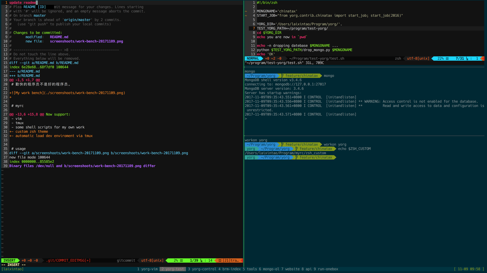

# 勤快的程序员不是好的程序员。

- Mac Gui app 使用 brew cask 管理；
- Mac 命令行程序使用 brew 管理；
- Python项目使用 virtualenvwrapper 管理；
- Python命令行工具使用 pipsi 管理；
- 虚拟机使用 vagrant 管理；

# myrc

My config files in Linux.

Now support:

- yarn
- bash
- zsh
- vim
- tmux
- some shell scripts for my own work
- custom zsh theme
- automatic load dev enviroment via tmux

## macOS charging info

Run `./bin/charging-info.py` to show battery status, battery power, charger
details, USB PD profiles, and input power telemetry when available.
Use `./bin/charging-info.py --watch 2` to refresh every two seconds.
Key readings are highlighted in terminals: green for charging, yellow for
discharging or battery levels of 21–40%, red for levels at or below 20%, and cyan
for charger/input power readings. Use `--color always` or `--color never` to
override automatic detection; auto mode respects `NO_COLOR` and `TERM=dumb`.
Requires Python 3; no third-party packages or sudo needed. Charger power limits
are separate from live input power and net battery charging power. Missing
device details or telemetry are shown as unavailable.

# Install COC

Go to `myrc/.config/coc/extensions` run `npm install`.

# usage

0. molokai color scheme
1. run install [myrc path]
2. Some Installation please refer to .vimrc
    1. BundleInstall
    2. YouCompleteMe Install
3. Install dircolors and solarized for terminal manually:https://www.kawabangga.com/posts/1887

need to set option key as Meta key from iterm2:
https://superuser.com/questions/649960/option-key-does-not-work-as-meta-in-tmux

1. install `xcode-select --install`
2. install `brew`
3. install zsh
4. install oh-my-zsh
5. install pipx `pipx install-all pipx.json`
